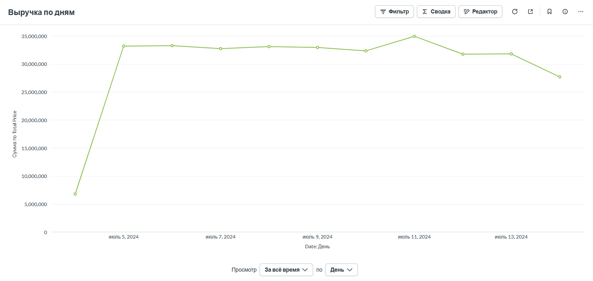

# Marketplace Data Pipeline (Airflow + PySpark + ClickHouse)


End-to-end ETL-пайплайн для обработки сырых данных маркетплейса Wildberries. Проект демонстрирует навыки построения отказоустойчивых пайплайнов, работы с большими данными и настройки инфраструктуры.

## Архитектура пайплайна

Пайплайн оркестрируется **Apache Airflow** и состоит из трех этапов:

1. **Extract (`extract.py`)**: Читает сырой Parquet-файл, валидирует данные через `Pydantic` и конвертирует их в формат NDJSON для потоковой загрузки.
2. **Transform (`transform.py`)**: Запускает **PySpark** сессию. Проводит проверку качества данных (Data Quality), удаляет аномалии (отрицательные цены, пустые ID) и агрегирует данные по дням и промо-акциям.
3. **Load (`load_clickhouse.py`)**: Пакетно загружает валидированные данные в **ClickHouse** с обеспечением идемпотентности (очистка партиции перед вставкой).

## Технологический стек

* **Orchestration:** Apache Airflow 2.9.3 (LocalExecutor)
* **Processing:** PySpark 3.5.0, Pandas, PyArrow
* **Storage:** ClickHouse (MergeTree), PostgreSQL (Airflow Metadata)
* **Infrastructure:** Docker, Docker Compose
* **Quality & Security:** Pydantic, Python-dotenv, Pytest

## Ключевые инженерные решения (Highlights)

* **Data Quality на лету:** Данные валидируются дважды — при выгрузке (через Pydantic) и при Spark-трансформации (отсев отрицательных цен и пустых артикулов).
* **Решение проблемы совместимости:** В ходе работы была решена проблема чтения Parquet-файлов, сохраненных Pandas (наносекунды TIMESTAMP(NANOS)), через настройки Spark nanosAsLong.
* **Идемпотентность:** Загрузка в ClickHouse защищена от дублирования. Перед каждой вставкой выполняется ALTER TABLE DELETE, привязанный к дате запуска DAG.
* **Безопасность:** Все секреты (пароли, хосты) вынесены в .env файл, который исключен из Git. Подключения к БД настроены через Airflow Connections.

## Как запустить локально

### Предварительные требования
Установленный Docker и Docker Compose.

### 1. Клонирование и настройка
Склонируйте репозиторий:

```bash
git clone <your-repo-url>
cd marketplace-data-pipeline
```

Создайте файл .env в корне проекта и добавьте туда настройки администратора Airflow:

```
AIRFLOW_ADMIN_USER=anna
AIRFLOW_ADMIN_PASSWORD=your_secure_password
AIRFLOW_ADMIN_EMAIL=anna@dev.local
```

### 2. Запуск инфраструктуры
Соберите образ (скачаются зависимости и Spark JAR'ы) и поднимите контейнеры:

```bash
docker-compose build
docker-compose up -d
```

### 3. Настройка Airflow
1. Откройте интерфейс Airflow: http://localhost:8080
2. Войдите под пользователем, созданным при первом запуске.
3. Перейдите в Admin -> Connections и создайте подключение к ClickHouse:
   * Connection Id: clickhouse_default
   * Connection Type: HTTP
   * Host: clickhouse
   * Port: 9000
   * Login: default

### 4. Запуск пайплайна
В интерфейсе Airflow найдите DAG wildberries_etl_pipeline_v2, включите его и нажмите Trigger DAG. 
Вы увидите, как задачи extract_wb_sales, spark_transform_data и load_to_clickhouse выполняются параллельно и последовательно.

## Тестирование

Для запуска unit-тестов (PySpark логика валидации данных):
```bash
docker-compose exec airflow python -m pytest tests/ -v
```

##  Структура проекта
```
├── dags/                  # DAG-файлы Airflow
├── src/                   # Исходный код ETL (extract, transform, load)
├── tests/                 # Unit-тесты на PySpark
├── docs/                  # Скриншоты и документация (дашборд)
├── clickhouse-config/     # Конфиги ClickHouse (users.xml)
├── docker-compose.yml     # Инфраструктура
├── Dockerfile             # Образ Airflow с Java и Spark
├── .env                   # Секреты (не коммитится)
└── requirements.txt       # Python-зависимости
```

## 📊 Визуализация данных (Metabase)

Для анализа данных мы используем **Metabase**. После того как ETL-пайплайн отработал и загрузил данные в ClickHouse, они автоматически становятся доступны в дашборде.



**Что на графике:** Динамика ежедневной выручки магазина. Видно, как менялся спрос в течение периода.

### Как запустить дашборд локально:
1. Запустите все контейнеры: `docker-compose up -d`
2. Перейдите по адресу: `http://localhost:3000`
3. Metabase автоматически подключен к ClickHouse (база `Wildberries Data`, таблица `wb_sales`).

**Автор:** Anna Olasyuk